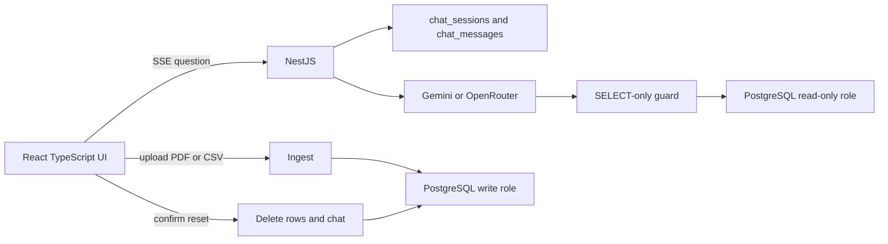

# Chat with your bank statements

Ask questions about transactions in plain English. The API turns the question into a single read-only SQL query, runs it on PostgreSQL, and answers from those rows.

## Architecture



The model receives the `v_transactions` columns, the category list, and a few question-to-SQL examples. It calls `run_sql_query`. Only a short row sample goes back to the model.

## Schema

There is no accounts table. Name, email, address, account number, CIF, IFSC, PAN, and Aadhaar are never stored.

`transactions` holds each statement line. The narration is messy, so the loader parses a merchant and a category with fixed rules. The same shop can be spelled several ways (`DMART AV`, `AVENUE S`) and still share one `source`. A person’s name is not guessed into food or groceries. The raw `description` stays on the row so a category can be checked against the statement. Classification does not call a model: a second run must produce the same head, and the narration should not be sent out for labeling.

Derivation order:

- A refund or a self-transfer wins before any shop name. A Swiggy reversal is a refund, not food.
- Merchant is the UPI payee token, otherwise a fixed label such as Interest, ATM, or Employer. A card purchase uses the shop name after the terminal number, with the city dropped. If nothing matches, merchant is `Unknown`.
- Category comes from a fixed pattern list. A UPI, NEFT, or IMPS line that matches no shop is `transfer`.

`category` is plain text: food, groceries, shopping, travel, entertainment, bills, cash, transfer, self_transfer, investment, interest, tax_refund, fees, refund, other.

On the statement a debit is money out and a credit is money in. In the client’s ledger the bank is an asset, so those sides are reversed. This schema keeps statement signs. Ledger signs are not applied here.

A debit and a credit are separate nullable columns. Exactly one is set. `v_transactions` adds `direction`, `amount`, and these measures:

- `is_expense` is spending. It is a debit that is not a refund, not a self-transfer, and not `transfer`, `self_transfer`, `investment`, or `cash`. Groww and an EMI such as Fibe are not expenses. ATM cash is a drawing: the expense happens later, outside this statement.
- `is_emi` is an EMI repayment, such as Fibe or a narration that says EMI. Spending including EMI is `is_expense OR is_emi`. A question about what was spent or paid per month is answered as expenses, EMI, and that combined total, on separate lines. EMI is never called an expense by itself.
- `is_outflow` is where money went. It includes EMI, person-to-person transfers, investment, and ATM cash, and still excludes refunds and self-transfers.
- `is_receipt` is money that came in, excluding loan credits. It is not earnings. Earnings are only `interest` and `tax_refund`.
- `is_loan_credit` is a loan or disbursement credit. It is borrowing, not a receipt and not income.

A refund (`UPI/REVERSAL`, `UPI/REV`, or `Refu`) is excluded from these measures and is not matched back to the original line. A self-transfer (`SELFTRANSFER`, or the local `SELF_UPI_HINT`) is neither income nor expense. The hint stays in `.env`.

The statement does not split EMI principal and interest, and the purchase the EMI relates to may not be on this statement, so the whole EMI stays a transfer and is never treated as an expense.

The category chart uses `is_expense`. The credit-and-debit chart is labelled cash movement: every credit and every debit, including self-transfers. It is not a profit and loss.

`chat_sessions` and `chat_messages` store follow-up history and the SQL behind each answer. A refused question is not saved, so it cannot unlock a later follow-up.

Chat SQL uses the `chat_ro` role, which can only select from `transactions` and `v_transactions`. Upload, reset, and seed use `chat_rw`.

## Data

`db/seed/transactions.csv` is synthetic: more than 500 rows from January 2025 through September 2025, with food, groceries, shopping, travel, bills, cash, a monthly Netflix charge, credits, a refund, and self-transfers. It is loaded on API startup when the table is empty.

A real statement PDF is not part of this repo. Upload one locally if you want. The parser keeps transaction lines and drops the account header.

Upload appends rows and returns how many were inserted or skipped. Before insert, the running balance of that file is checked in integer paise. The file may be oldest-first or newest-first. A break rejects the upload and names the row. The check does not compare this file with rows already stored. A PDF that has a summary page is still checked against that summary. `row_hash` skips a duplicate line. Reset deletes transactions and chat history.

## Setup

From this folder:

```bash
cp .env.example .env
```

Put `GEMINI_API_KEY` in `.env` only when you want chat answers. Parsing, the chart, upload, and reset do not call the model. `LLM_PROVIDER=openrouter` needs `OPENROUTER_API_KEY` instead.

```bash
docker compose up --build
```

Open http://localhost:5173.

If Docker is not installed, start a local Postgres from `backend` with `npm run db:local`, then `npm run start:dev` in another terminal, and `npm run dev` in `frontend`.

The API is on port 3000. The UI proxies `/api` to it.

To regenerate the synthetic file:

```bash
cd backend
npm install
npm run generate-seed
```

Parser and SQL-guard tests:

```bash
npm test
```

Question checks against the database, after the stack is up:

```bash
npm run eval
```

Results are written to `eval/results.json`.

## Demo script

1. Open the app and ask "How much did I spend on eating out last month?"
2. Open Show SQL and confirm the query filters food debits in August 2025.
3. Ask "What about the month before?"
4. Ask "Give me a category-wise spending breakdown for the last 3 months." and look at the bar chart.
5. Ask "What are my top 5 merchants by spend?"
6. Upload a CSV or a statement PDF and note the inserted count.
7. Upload the same file again and note that the rows are skipped.
8. Reset, confirm, and see the empty chat.

## Safety

- Chat SQL uses `chat_ro`. Generated SQL must be one `SELECT` or `WITH ... SELECT`. Writes, comments, and a second statement are rejected, then the query is wrapped with a limit of 200 rows. The read connection times out after 5 seconds.
- Narration text is untrusted. The prompt tells the model not to follow instructions inside it. Tool results sent to the model omit `description` and `ref_no`, keep at most 10 sample rows, and mask digit runs of 9 or more. The same mask is applied to server logs. The table in the browser still shows the rows from the query.
- Questions are screened locally, before the model is called and before the message is saved. Account number, IFSC, CIF, phone number, PAN, and Aadhaar are refused. Email and address are refused when the question is asking for them. Abusive language and questions that are not about transactions or a calculation are refused with a fixed sentence. A short follow-up is allowed only when that chat already has a saved question.
- Keys and database URLs come from environment variables. `.env.example` has empty secrets. `.env` and `*.pdf` are gitignored. The committed seed is synthetic. Do not put a real statement in the repository.
